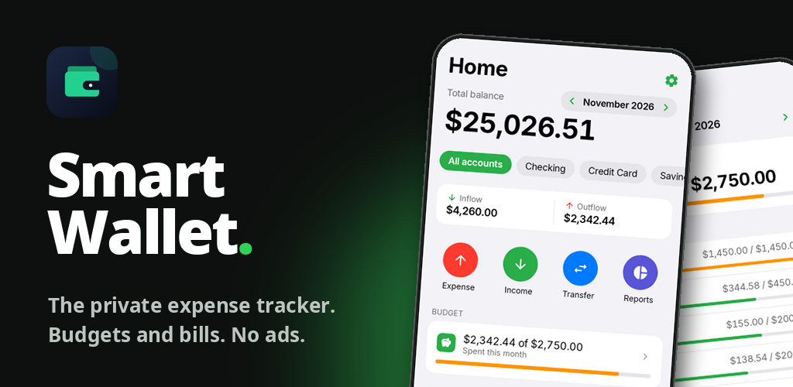
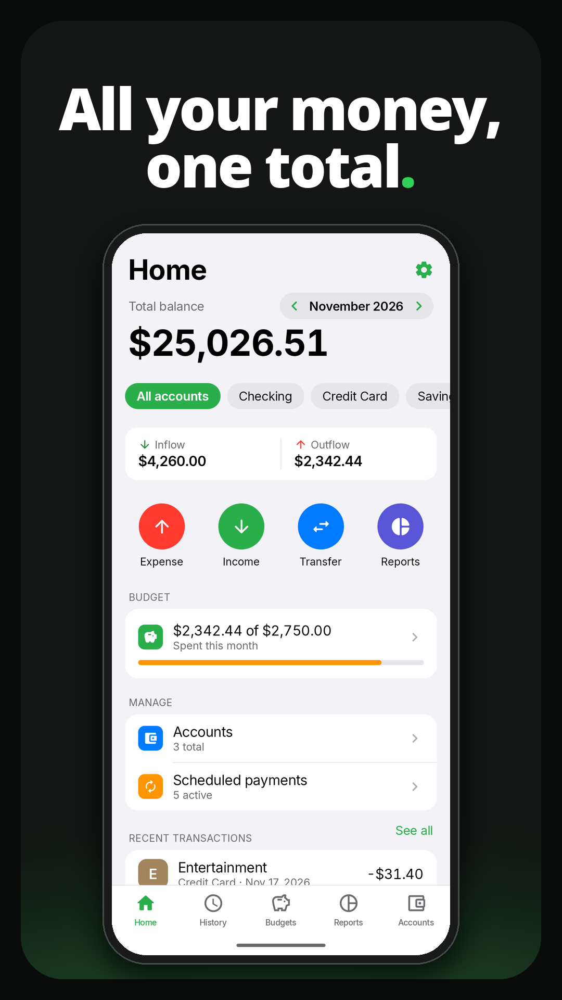
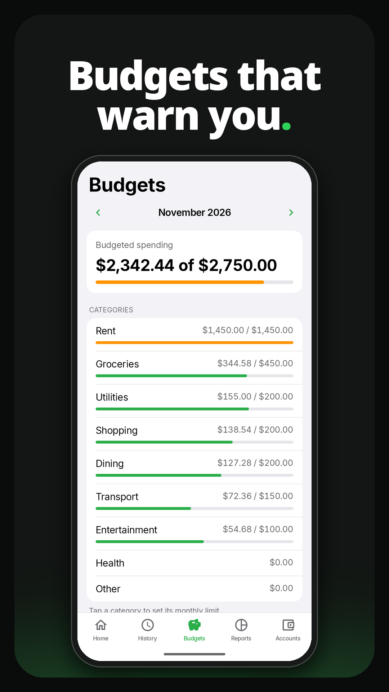
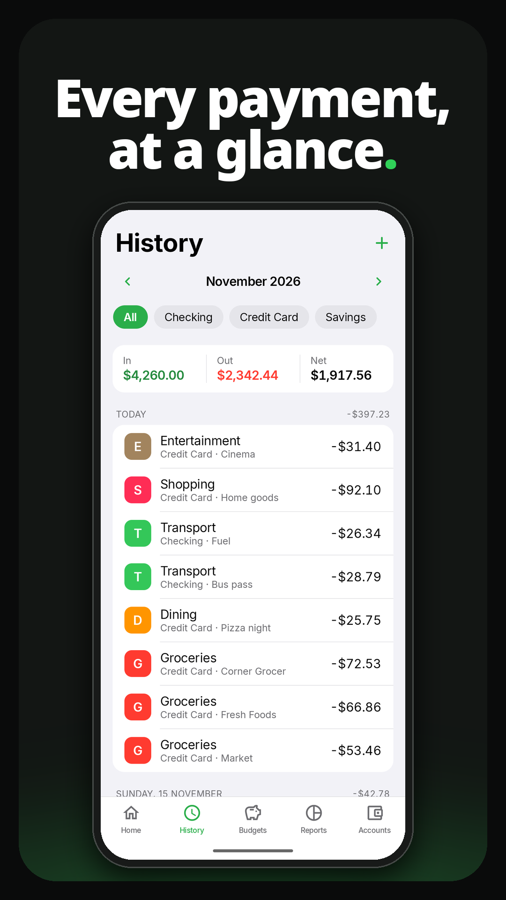
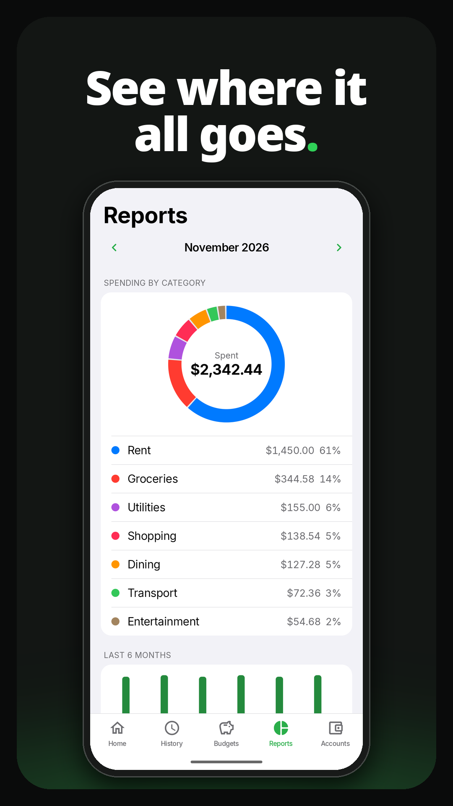
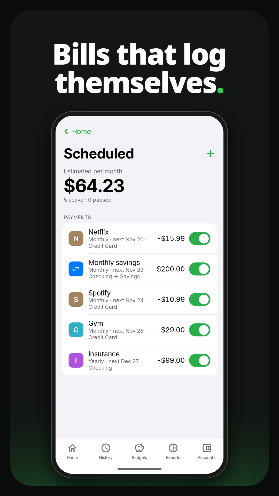
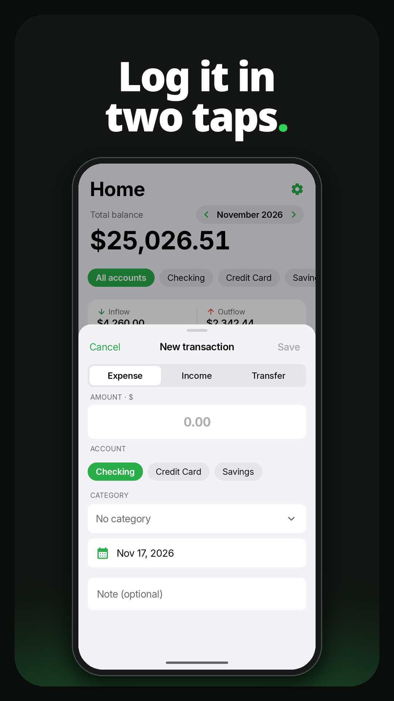
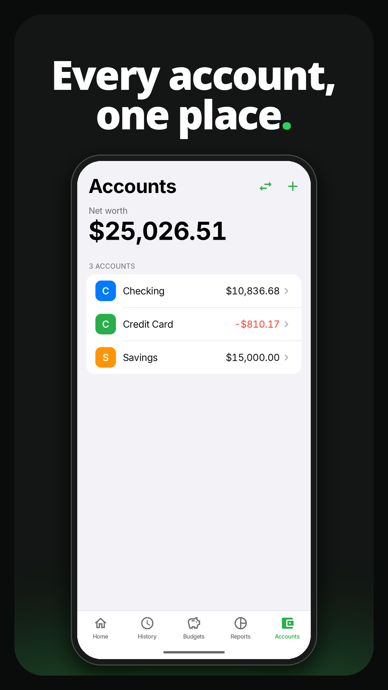
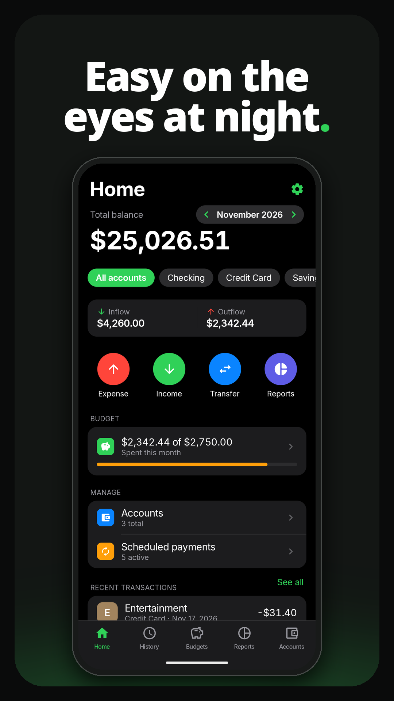

<div align="center">


# Expense Tracker - SmartWallet

**The private expense tracker for Android.**
All your money in one total, budgets that warn you, and bills that log themselves. It works fully offline, with no account, no ads and no internet permission.


[](https://github.com/BallbeIan/SmartWallet/releases/latest)

**[Download the latest APK](https://github.com/BallbeIan/SmartWallet/releases/latest)** · [How to install](#install) · A Google Play release is planned.



</div>

---

## What it does

- **All your money, one total.** The home screen shows the total across every account: cash, bank, card, savings, as many as you like. Tap an account to see just that one: its balance, its month, its recent activity.
- **Log it in two taps.** Expense, Income and Transfer are one tap away, with categories, dates and notes. Transfers between your accounts don't count as income or spending.
- **Budgets that warn you.** Set a monthly limit per category and watch the bar turn amber, then red.
- **Every payment, at a glance.** History shows a month at a time, grouped by day, with an In / Out / Carried / Net summary and a filter per account.
- **See where it all goes.** Spending by category as a donut chart, plus income against expenses for the last six months.
- **Bills that log themselves.** Add Netflix, rent, a salary or a monthly transfer to savings once (weekly, monthly or yearly, on the day you choose). Each one lands in History on its due date, and a reminder can tell you up to three days before. Pause one with a switch.
- **Month end, your way.** When a month is over, leave the leftover in place, move it to another account, or cover an overspend from savings. See [How Month end works](#how-month-end-works).
- **App lock.** A 4–6 digit PIN with optional fingerprint or face. It locks when you leave (immediately or after 1, 5 or 15 minutes), hides its preview in the recent-apps list, and slows down guessing. A forgotten PIN can be reset with the phone's own screen lock (Android 11+).
- **Export and import.** Save exactly what you choose (accounts, categories, transactions, budgets, scheduled payments, settings) to one backup file and bring it back on any phone. Importing never overwrites, and the same file can be imported twice safely. A CSV of transactions is also available for spreadsheets.
- **Your look, your currency.** Light or dark theme, or follow the phone. Any currency, shown with its own symbol and formatting.
- **Private by design.** The app **never asks for the internet permission**. No account, no analytics, no ads.

### How Month end works

Choose the account you spend from, then decide what happens when a month is over:

- **Money left over:** leave it for next month, or move it to another account. A *keep in the account* amount is never moved.
- **If you overspend:** carry the negative balance over, or cover it from another account.
- **What you see:** a transfer in History dated the last day of the month, and a *Carried over from October* entry on the 1st. The pair cancels out, so balances don't change, but the new month's net includes it.
- **Always up to date:** the entries are calculated from your transactions, not saved once. Change a transaction in an earlier month and every later month-end entry is recalculated.

## Install

SmartWallet needs Android **8.0 (API 26) or newer**.

### Google Play

A Google Play release is planned. This section will link to it once it is live.

### GitHub (APK)

1. On your phone, open the [latest release](https://github.com/BallbeIan/SmartWallet/releases/latest) and download `SmartWallet-<version>.apk`. Open it and allow your browser or file manager to install apps when Android asks.
2. Open **Expense Tracker - SmartWallet**, add your first account with the **+** button, and start logging.
3. *(Optional)* In Settings, switch on **Payment reminders** to get a notification before a scheduled payment is due.

Newer APKs install over an older one and keep your data.

To check the download, compare its SHA-256 with the `.sha256` file on the release page. The APK is signed with the project's release key, whose certificate SHA-256 is `d0e9851f05844377b84f1f31efe98aca5c2f06b37a5cf9bec6415c276894bf30` (check it with `apksigner verify --print-certs`).

### Switching between Play and GitHub

Google Play signs the app with Google's own key, and the GitHub APK is signed with the project's key. Android treats them as different signatures, so **one cannot update the other**. To switch, export your data in **Settings > Export**, uninstall the app, install the other version and use **Settings > Import**. Uninstalling deletes the app's data, so export first.

## Screenshots

<table>
  <tr>
    <td></td>
    <td></td>
    <td></td>
  </tr>
  <tr>
    <td></td>
    <td></td>
    <td></td>
  </tr>
  <tr>
    <td></td>
    <td></td>
    <td></td>
  </tr>
</table>

<sub>The screenshots show made-up demo data.</sub>

## Building from source

You need JDK 17 and the Android SDK (platform 36, build-tools 36.0.0).

```powershell
git clone https://github.com/BallbeIan/SmartWallet.git
cd SmartWallet
$env:ANDROID_HOME = "$env:LOCALAPPDATA\Android\Sdk"
.\gradlew.bat assembleDebug    # app\build\outputs\apk\debug\app-debug.apk
.\gradlew.bat installDebug     # onto a connected phone
.\gradlew.bat lint
```

On macOS or Linux, use `export ANDROID_HOME=~/Android/Sdk` and `./gradlew` instead. Or open the folder in Android Studio and run it on a device.

Release builds are signed with the key named in `keystore.properties` (copy `keystore.properties.example`; the file and the key are git-ignored). Without it, release builds fall back to the debug key, which is fine for local testing but not for publishing. Tagged releases (`v<version>`) are built, signed and published by [`.github/workflows/release.yml`](.github/workflows/release.yml).

### Trying it with sample data

Debug builds have a **Developer** section in Settings with *Load demo data* and *Clear all data*. To see the app filled in without touching your own data, install the separate `demo` build, which has its own database, and start it with the sample data:

```powershell
.\gradlew.bat installDemo
adb shell am start -n app.smartwallet.expensetracker.demo/app.smartwallet.MainActivity --ez demo true
```

The screenshots above were taken this way.

### How it works

```
 Compose screens ──►  WalletViewModel  ──►  Room database (accounts, categories, transactions, budgets, scheduled)
  Home · History         │                         ▲
  Budgets · Reports      │ monthEndChanged()       │ writes only when something differs
  Accounts · Settings    ▼                         │
                  computeMonthEnd()  ──►  reconcileMonthEnd()      WorkManager (daily, 09:00)
                  (pure function)                                   · adds due scheduled payments
                                                                    · posts reminders
```

- Amounts are stored as whole **cents**, so there are no rounding errors; only the display follows the chosen currency.
- **Month end is derived data.** `computeMonthEnd` is a pure function from the real transactions to the entries that should exist; `reconcileMonthEnd` makes the database match it and writes nothing when it already does.
- **Scheduled payments** become ordinary transactions on their due date, so budgets and reports pick them up with no special cases.
- **The PIN is never stored**, only a salted PBKDF2 hash. While the app is locked its screens are not composed at all, so nothing behind the lock screen can be read.
- Libraries: Jetpack Compose (Material 3), Room, WorkManager and AndroidX Biometric. Nothing else. The Inter font is bundled, so nothing is fetched at run time.

| Path | What it does |
|---|---|
| `app/src/main/java/app/smartwallet/data/` | Room entities and DAO, money formatting, CSV, month-end and scheduled-payment logic |
| `app/src/main/java/app/smartwallet/ui/` | One file per screen, the shared dialogs and the theme |
| `WalletViewModel.kt` | App state, and the single place data is changed |
| `Reminders.kt` | Reminder settings, scheduling and the daily worker |
| `AppLock.kt` | PIN storage (salted PBKDF2 hash only), lock state and timing |

Developed and tested on a Samsung foldable phone. Other phones should work, since the app uses only standard Android components. Device reports are welcome.

## Privacy

SmartWallet collects nothing and never connects to the internet. Everything you enter stays in a local database on your phone. Read the full [privacy policy](docs/PRIVACY.md).

| Permission | Why |
|---|---|
| Notifications *(optional)* | Payment reminders. Asked for only when you switch reminders on. |
| Biometrics, fingerprint | Declared by AndroidX Biometric so the app lock can use your fingerprint or face. Optional, and only used if you switch it on. |
| Wake lock, boot completed, foreground service, network state | Declared by AndroidX WorkManager so the daily check survives a reboot. SmartWallet does not use the network. |

There is **no internet permission**. See the merged list with `aapt2 dump permissions app-debug.apk`.

## Contributing

Bug reports and device reports are welcome in [Issues](https://github.com/BallbeIan/SmartWallet/issues). See [CONTRIBUTING.md](CONTRIBUTING.md).

## Licence

SmartWallet is **source-available** under the [PolyForm Noncommercial License 1.0.0](LICENSE). You may read, learn from, modify and build it for personal and other noncommercial use. Commercial use, including selling or publishing it, is not permitted.

The interface uses [Inter](https://github.com/rsms/inter), bundled in the app, under the SIL Open Font License ([`docs/licenses/Inter-OFL.txt`](docs/licenses/Inter-OFL.txt)).
