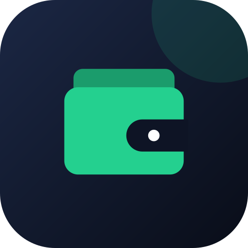
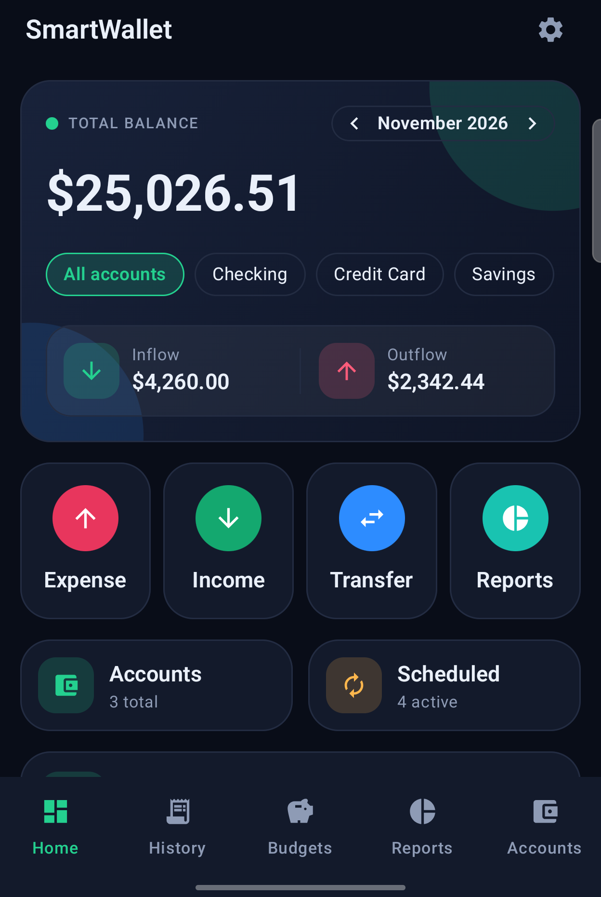
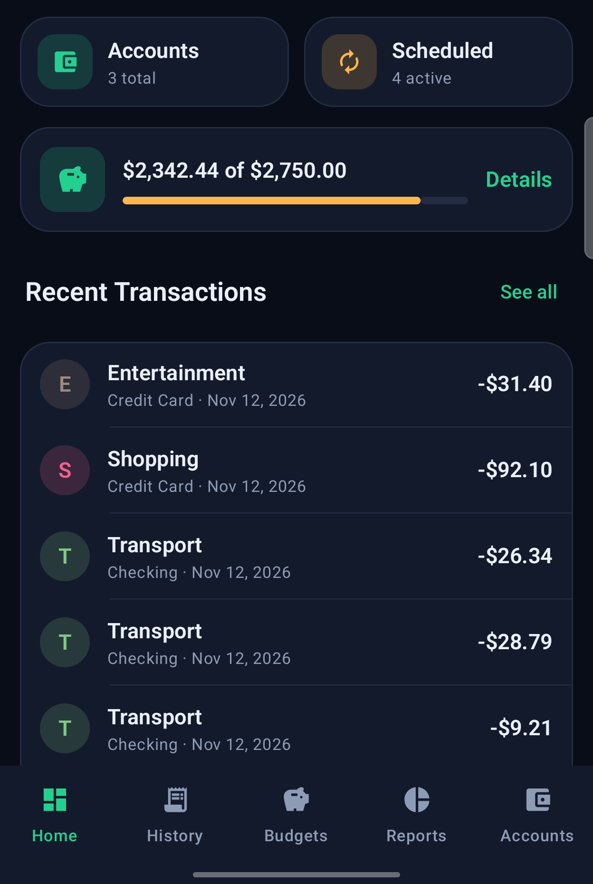
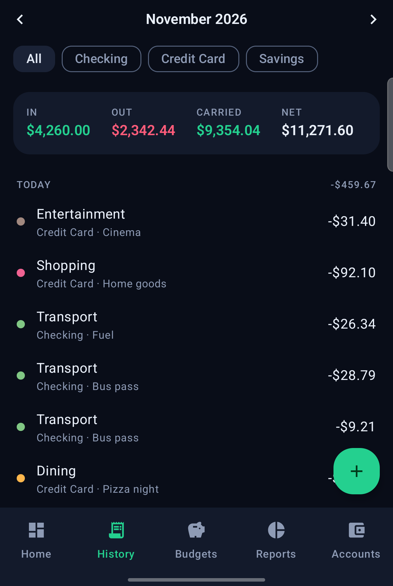
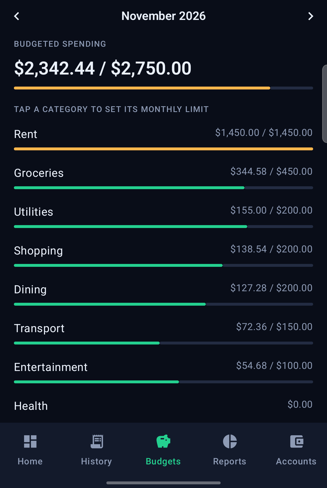
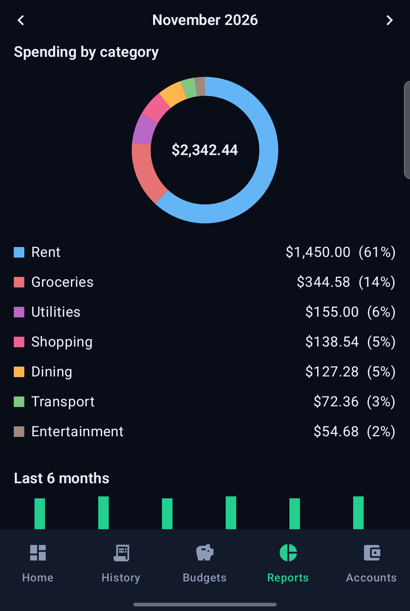
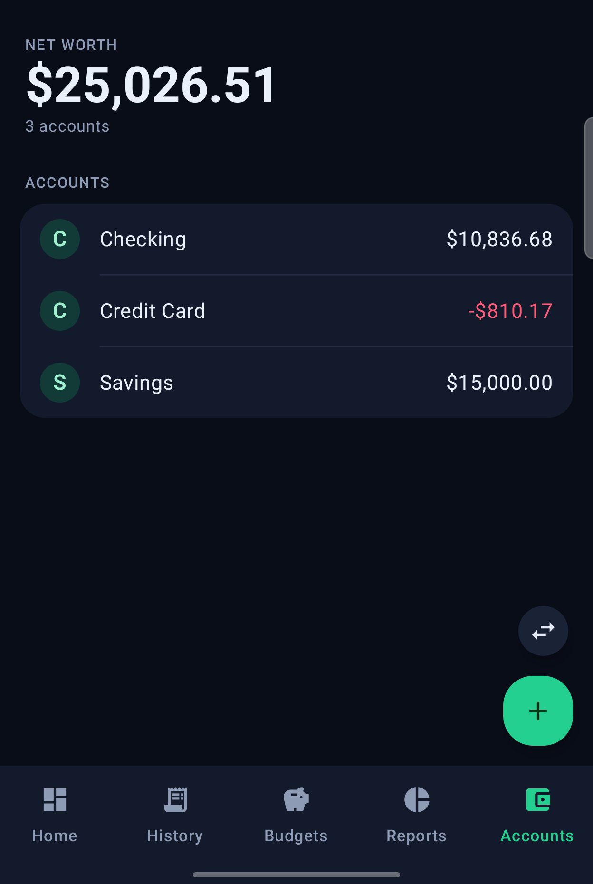
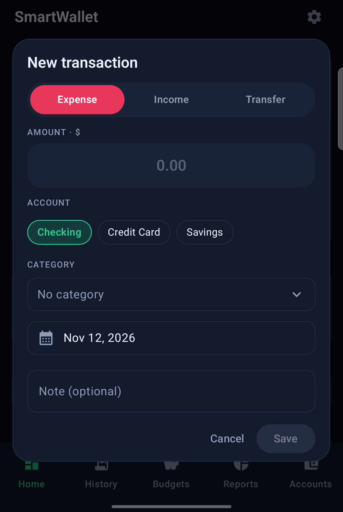
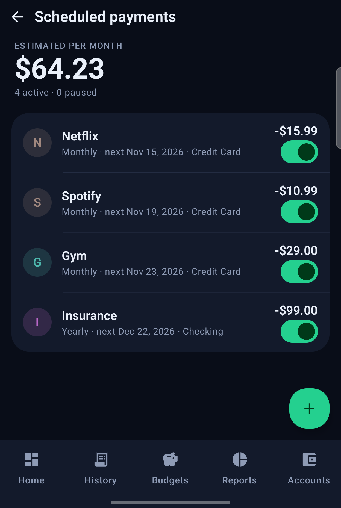
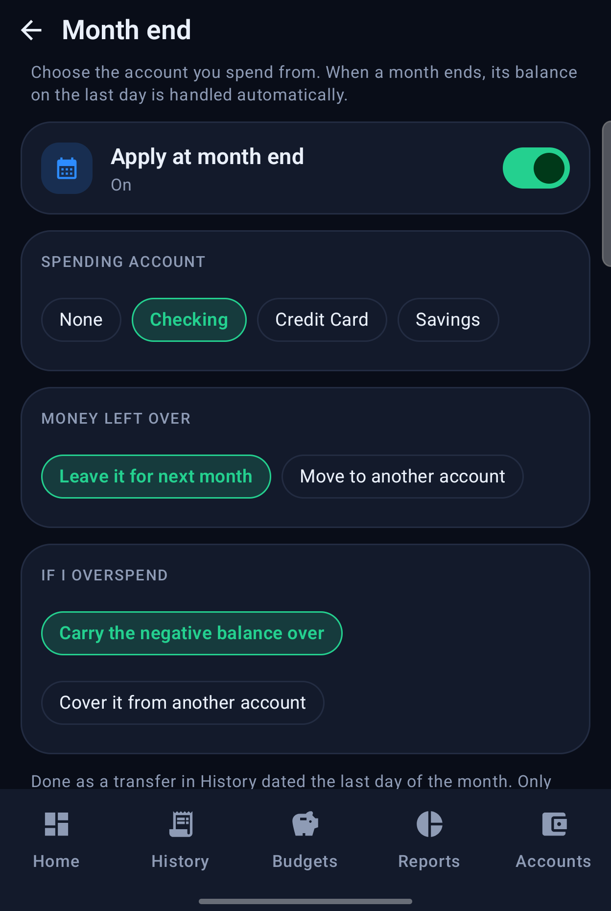

<div align="center">



# SmartWallet

**A private expense tracker for Android.**
Keep all your accounts in one place, log what you spend, set monthly budgets, schedule subscriptions, and let the app deal with what's left over when a month ends.


</div>

---

## Highlights

- **One total, any account.** The home screen shows the total across every account. Tap an account to look at just that one: its balance, its month, its recent activity.
- **Fast logging.** Expense, Income and Transfer are one tap away, with categories, dates and notes. The dialogs fit on one screen and never open the keyboard until you ask.
- **Budgets that warn you.** Set a monthly limit per category and watch the bar turn amber, then red.
- **Scheduled payments.** Add Netflix, rent or a salary once (weekly, monthly or yearly). Each occurrence lands in History on its due date, and a reminder can tell you a day or two before.
- **Month end, your way.** Pick the account you spend from. When a month is over, leave the leftover in place, move it to another account, or cover an overspend from savings. Anything that stays is shown as a *Carried over* entry, and it is recalculated for every month whenever you edit the past.
- **Private by design.** The app **never asks for the internet permission**. Your data lives in a local database on the phone, and there is no account, no analytics and no ads.
- **Your currency.** Pick any currency; amounts are shown with its symbol and formatting.

## Screenshots

<table>
  <tr>
    <td></td>
    <td></td>
    <td></td>
  </tr>
  <tr>
    <td></td>
    <td></td>
    <td></td>
  </tr>
  <tr>
    <td></td>
    <td></td>
    <td></td>
  </tr>
</table>

<sub>The screenshots show made-up demo data.</sub>

## What it does

| | |
|---|---|
| 🏠 **Home** | Total balance, an account selector, the month's inflow and outflow, quick actions, the budget, and recent transactions. |
| 🧾 **History** | A month at a time, grouped by day, with an In / Out / Carried / Net summary and a filter per account. |
| 💰 **Accounts** | Cash, bank, card, savings: as many as you like, each with its own starting balance. Transfers between accounts don't count as income or spending. |
| 📊 **Budgets** | A monthly limit per category with progress bars, and a total for the month. |
| 🥧 **Reports** | Spending by category as a donut chart, plus income against expenses for the last six months. |
| 🔁 **Scheduled** | Subscriptions and repeating payments. Pause one with a switch. Optional reminders at 09:00, from the same day up to three days ahead. |
| 📅 **Month end** | Leftover and overspend rules for the account you spend from. Applies to all months, always. |
| 📁 **CSV** | Export everything to a file, or import a bank statement; missing accounts and categories are created for you. |

## How Month end works

Choose the account you spend from, then decide what happens when a month is over:

- **Money left over:** leave it for next month, or move it to another account. A *keep in the account* amount is never moved.
- **If you overspend:** carry the negative balance over, or cover it from another account.
- **What you see:** a transfer in History dated the last day of the month, and a *Carried over from October* entry on the 1st. The pair cancels out, so balances don't change, but the new month's net includes it.
- **Always up to date:** the entries are calculated from your transactions, not saved once. Change a transaction in an earlier month and every later month-end entry is recalculated.

## Requirements and compatibility

- Android **8.0 (API 26) or newer**. Built against API 36.
- Developed and tested on a Samsung foldable phone. Other phones should work, since the app uses only standard Android components. Reports are welcome.

## Permissions

| Permission | Why |
|---|---|
| Notifications *(optional)* | Payment reminders. Asked for only when you switch reminders on. |
| Wake lock, boot completed, foreground service, network state | Declared by AndroidX WorkManager so the daily check survives a reboot. SmartWallet does not use the network. |

There is **no internet permission**. See the merged list with `aapt2 dump permissions app-debug.apk`.

## How it works

```
 Compose screens ──►  WalletViewModel  ──►  Room database (accounts, categories, transactions, budgets, scheduled)
  Home · History         │                         ▲
  Budgets · Reports      │ monthEndChanged()       │ writes only when something differs
  Accounts · Settings    ▼                         │
                  computeMonthEnd()  ──►  reconcileMonthEnd()      WorkManager (daily, 09:00)
                  (pure function)                                   · adds due scheduled payments
                                                                    · posts reminders
```

- Amounts are stored as whole **cents**, so there are no rounding errors; only the display follows the chosen currency.
- **Month end is derived data.** `computeMonthEnd` is a pure function from the real transactions to the entries that should exist; `reconcileMonthEnd` makes the database match it and writes nothing when it already does.
- **Scheduled payments** become ordinary transactions on their due date, so budgets and reports pick them up with no special cases.
- Libraries: Jetpack Compose (Material 3), Room, WorkManager. Nothing else.

| Path | What it does |
|---|---|
| `app/src/main/java/app/smartwallet/data/` | Room entities and DAO, money formatting, CSV, month-end and scheduled-payment logic |
| `app/src/main/java/app/smartwallet/ui/` | One file per screen, the shared dialogs and the theme |
| `WalletViewModel.kt` | App state, and the single place data is changed |
| `Reminders.kt` | Reminder settings, scheduling and the daily worker |

## Building from source

You need JDK 17 and the Android SDK (platform 36, build-tools 36.0.0).

```bash
git clone https://github.com/BallbeIan/SmartWallet.git
cd SmartWallet
export ANDROID_HOME=~/Android/Sdk
./gradlew assembleDebug        # app/build/outputs/apk/debug/app-debug.apk
./gradlew installDebug         # onto a connected phone
./gradlew lint
```

Or open the folder in Android Studio and run it on a device.

### Trying it with sample data

Debug builds have a **Developer** section in Settings with *Load demo data* and *Clear all data*. To see the app filled in without touching your own data, install the separate `demo` build, which has its own database, and start it with the sample data:

```bash
./gradlew installDemo
adb shell am start -n app.smartwallet.demo/app.smartwallet.MainActivity --ez demo true
```

The screenshots above were taken this way.

## Contributing

Bug reports and device reports are welcome. See [CONTRIBUTING.md](CONTRIBUTING.md).

## License

SmartWallet is **source-available** under the [PolyForm Noncommercial License 1.0.0](LICENSE). You may read, learn from, modify and build it for personal and other noncommercial use. Commercial use, including selling or publishing it, is not permitted.
